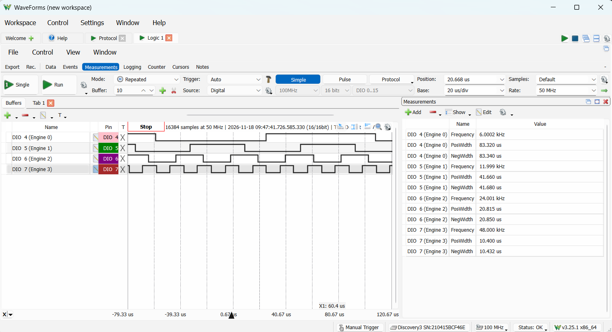
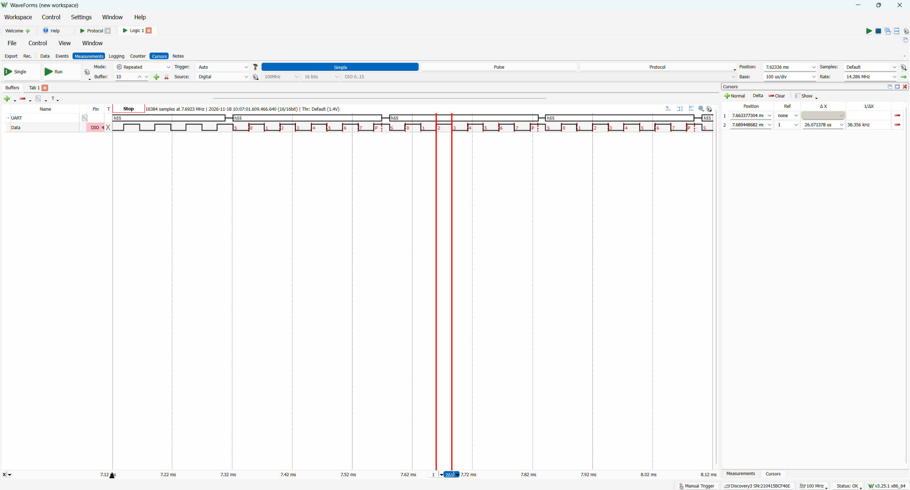
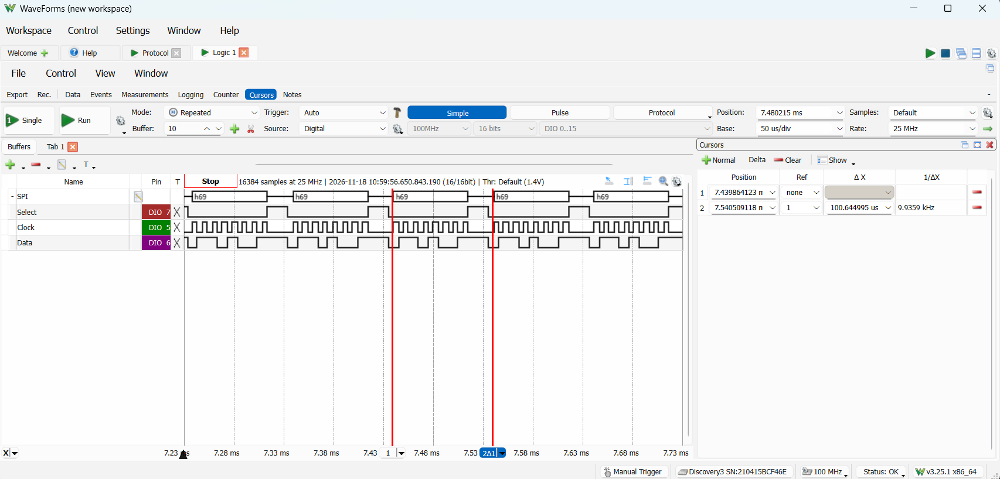
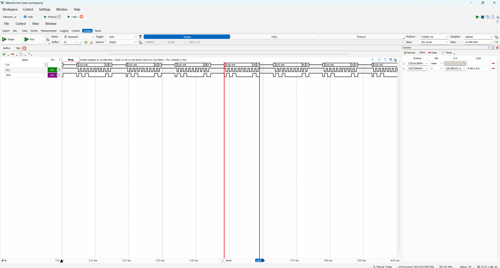
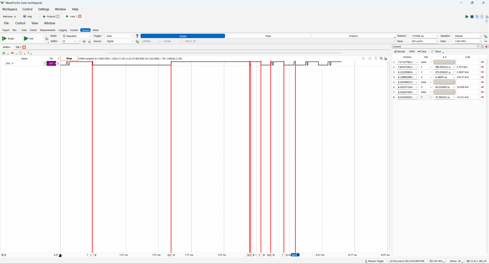
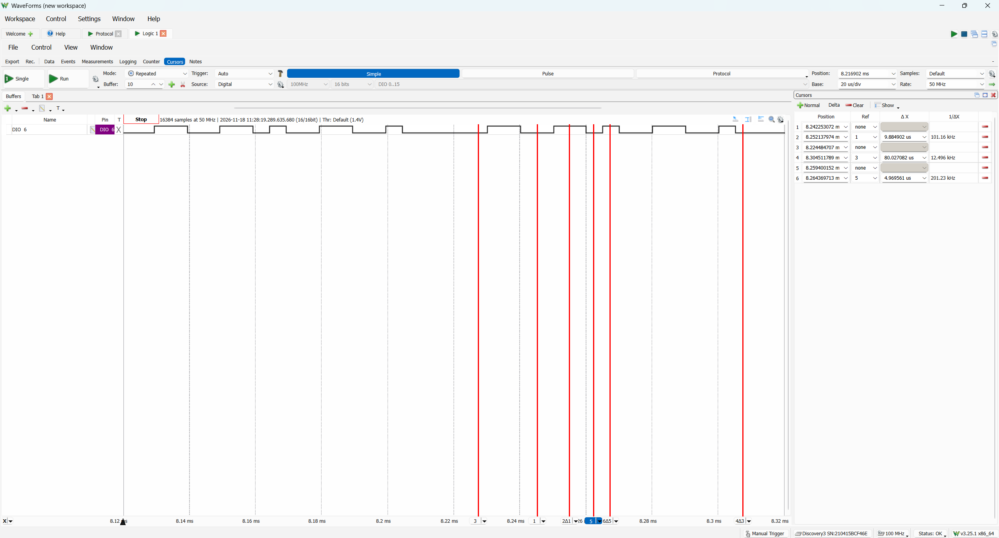
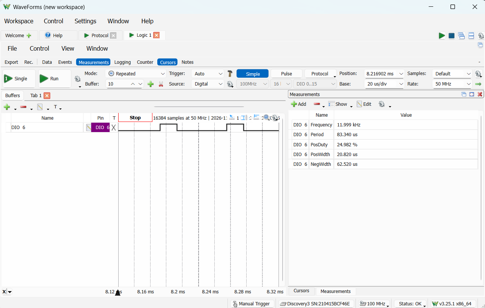
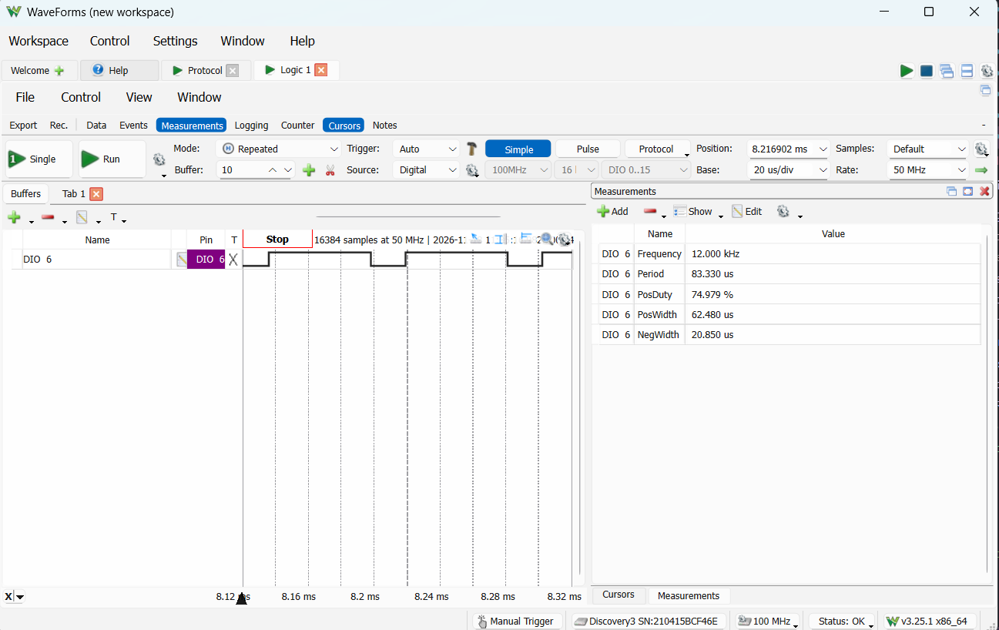

# PE16 Protocol Engine: Technical Report

Jane Street Protocol Emulator ASIC Competition
IHP SG13CMOS5L 130 nm — Tiny Tapeout 8×4
Submission deadline: January 18, 2027

This report describes the PE16 architecture, RTL, instruction set, protocol firmware, verification methodology, and physical implementation. The design has completed the Tiny Tapeout GDS workflow and has also been implemented and tested on a Digilent Basys3 FPGA.

Detailed verification results are maintained in [verification.md](verification.md). The [ISA reference](isa.md) and [protocol firmware reference](protocols.md) provide additional implementation details.

## Contents

1. Summary
2. Design constraints
3. System architecture
4. Protocol engine RTL
5. Top-level integration and instruction memory
6. Instruction set and assembler
7. Firmware techniques
8. Protocol implementations
9. Verification
10. ASIC implementation and timing
11. FPGA implementation and hardware testing
12. Design considerations and future work
13. Reproducing the results
14. References

---

## 1. Summary

PE16 is a programmable, multi-engine processor for digital communication protocols. Each engine is a small 16-bit, single-issue processor with an instruction set optimized for controlling pins at precise cycle intervals. Protocol behavior is implemented in firmware, allowing the same hardware to support interfaces ranging from UART and SPI to CAN, USB low-speed signaling, and MIL-STD-1553.

The design includes a deadline-based delay instruction (`DLY`), a configurable CRC unit, hardware bit stuffing and destuffing, NRZI encoding/decoding, and complementary differential output. Four engines execute independently, sharing eight bidirectional protocol pins through programmable output ownership. A host SPI interface programs instruction memory, configures engines, transfers data through FIFOs, and controls execution.

| Item | Specification |
|---|---|
| Technology | IHP SG13CMOS5L, 130 nm |
| Tiny Tapeout allocation | 8×4 tiles |
| Engines | Four independent 16-bit processors |
| Instruction memory | Four IHP 256×16 SRAM macros |
| Nominal system clock | 48 MHz |
| ASIC timing constraint | 20 ns (50 MHz) |
| Protocol I/O | Eight shared bidirectional pins |
| Host interface | SPI mode 0, up to `clk/8` |
| Per-engine FIFOs | Four 16-bit words each for TX and RX |
| Firmware | 23 programs covering 16 protocols |
| Top-level cocotb regression | 36 tests |
| Lean proofs | Eight theorems |
| ASIC implementation | GDS, precheck, LVS, and gate-level tests passed |
| FPGA implementation | Basys3, 48 MHz, hardware protocol tests completed |

The final ASIC contains 0.2212 mm² of standard cells and 0.1125 mm² of SRAM macros, for 0.3337 mm² combined cell and macro area within a 1.2253 mm² die allocation. Multi-corner post-layout static timing analysis reports +6.344 ns worst setup slack and +0.102 ns worst hold slack.

The FPGA prototype validated multi-engine execution, UART, SPI, I²C, 1-Wire, Manchester, NRZI, PWM, host programming, and shared pin configuration using an Analog Discovery 3.

## 2. Design constraints

### 2.1 Process and area

PE16 targets Tiny Tapeout's IHP SG13CMOS5L process. The final competition configuration uses an 8×4 tile allocation with a die outline of 1724.16 × 710.64 µm, or approximately 1.225 mm².

The area budget motivates the use of small programmable engines instead of separate, full-featured hardware controllers for every supported protocol. Instruction storage is implemented using four compiled SRAM macros rather than standard-cell register arrays.

The default ASIC contains four engines. A separate `PE_FLOP_IMEM` configuration provides two engines with 128-word flip-flop instruction memories for environments without the SRAM macro.

### 2.2 External pins

The Tiny Tapeout design template provides a fixed top-level interface.

| Port | Width | PE16 use |
|---|---:|---|
| `ui_in` | 8 | Bits 0–2: host SCK, CS_N, MOSI |
| `uo_out` | 8 | Bit 0: MISO; bits 1–3: aggregate halt, overrun, run status |
| `uio_in` | 8 | Protocol input signals |
| `uio_out` | 8 | Protocol output values |
| `uio_oe` | 8 | Per-pin output enables |
| `clk` | 1 | System clock |
| `rst_n` | 1 | Active-low global reset |
| `ena` | 1 | Tiny Tapeout enable input |

The eight `uio` pins support bidirectional and open-drain interfaces. Every engine can sample all eight inputs, while programmable ownership ensures that only the selected engine controls a physical pin's output value and output enable.

The remaining `ui_in` and `uo_out` bits are reserved for potential expansion.

### 2.3 Clocking and interface rates

The nominal PE16 clock is 48 MHz, giving a cycle time of approximately 20.833 ns. This frequency provides exactly 32 clock cycles per USB low-speed bit at 1.5 Mb/s and convenient timing for the other firmware implementations.

The ASIC physical-design configuration uses a 20 ns clock constraint, corresponding to 50 MHz. The resulting implementation therefore meets the intended 48 MHz operating target with additional timing margin.

All host SPI and protocol inputs pass through synchronizers before reaching the synchronous control logic. The host SPI interface supports SCK up to one-eighth of the system clock, or 6 MHz at 48 MHz.

## 3. System architecture

PE16 consists of a shared SPI host controller, four independent protocol engines, four instruction memories, and a configurable pin-routing network.

```text
                        tt_um_pe16
  +-----------------------------------------------------------+
  |                                                           |
  |  Host SPI interface                                       |
  |  SCK, CS_N, MOSI --> Synchronizers --> Command decoder    |
  |                                         |                 |
  |              +--------------------------+---------+       |
  |              |                          |         |       |
  |        Program/configuration      FIFO transfer   |       |
  |              |                          |         |       |
  |    +---------+----------+---------------+---------+       |
  |    |                    |                         |       |
  |    v                    v                         v       |
  | +-----------+      +-----------+             +-----------+ |
  | | Engine 0  |      | Engine 1  |             | Engine 3  | |
  | | 256x16    |      | 256x16    |     ...     | 256x16    | |
  | | SRAM      |      | SRAM      |             | SRAM      | |
  | | TX/RX FIFO|      | TX/RX FIFO|             | TX/RX FIFO| |
  | +-----+-----+      +-----+-----+             +-----+-----+ |
  |       |                  |                         |       |
  |       +------------------+-------------------------+       |
  |                          |                                 |
  |                 PIN_OWNER / PIN_VALID                      |
  |                          |                                 |
  |                  Output ownership mux                      |
  |                          |                                 |
  |                    uio_out / uio_oe                         |
  |                          |                                 |
  |                Eight bidirectional pins                    |
  |                          |                                 |
  |         uio_in --> Synchronizers --> All engines           |
  +-----------------------------------------------------------+
```

Each engine maintains its own program counter, registers, CRC and line-coding state, pin-control registers, and transmit/receive FIFOs. Engines do not share execution state or instruction memories.

### 3.1 Data movement

There is no external parallel data bus. The host communicates through SPI, and data passes through the engines' shift registers.

**Transmit path:**

```text
Host SPI -> TX FIFO -> PULL -> OSR -> OUT -> protocol pin
```

**Receive path:**

```text
Protocol pin -> IN -> ISR -> PUSH -> RX FIFO -> Host SPI
```

The output shift register (`osr`) and input shift register (`isr`) each hold 16 bits. Their shift directions are configurable independently, supporting both LSB-first and MSB-first protocols.

Each TX and RX FIFO holds four 16-bit words. An engine stalls at `PULL` if its TX FIFO is empty and at `PUSH` if its RX FIFO is full. The host can service either FIFO while the engine is executing.

### 3.2 Independent execution

The host selects an engine using the upper two bits of each SPI command byte. It can stop, program, configure, start, or reset an engine independently of the others.

The four engines can execute different programs simultaneously. For example, separate engines may generate a serial clock, transmit data, receive data, and monitor a bus concurrently.

Because timing is controlled by each engine's own deadline timer, one engine's branches or FIFO operations do not modify the timing state of another.

### 3.3 Shared pin routing

Each of the eight protocol pins has a two-bit owner field in the global `PIN_OWNER` register. A separate eight-bit `PIN_VALID` mask controls whether each assignment is active.

For pin `p`:

- `PIN_OWNER[2*p +: 2]` selects Engine 0, 1, 2, or 3.
- `PIN_VALID[p]` determines whether the selected engine is connected to the physical output.
- The selected engine's `pout[p]` and `poe[p]` determine its output value and enable.

The physical pin remains high-impedance when its validity bit or the owner's output-enable bit is cleared. All engines can read the synchronized physical inputs regardless of output ownership.

This routing allows multiple engines to use disjoint outputs, while still supporting applications where one engine transmits and another observes the same physical signal.

## 4. Protocol engine RTL

The core is implemented in [src/pe_core.v](../src/pe_core.v). It is a small single-issue machine with a synchronous instruction-memory interface and no conventional multi-stage instruction pipeline.

### 4.1 Architectural state

| Register | Width | Purpose |
|---|---:|---|
| `pc` | 8 | Program counter |
| `x`, `y` | 16 each | General values and loop counters |
| `osr` | 16 | Output shift register |
| `isr` | 16 | Input shift register |
| `crc` | 16 | Configurable CRC accumulator |
| `pout` | 8 | Pin output values |
| `poe` | 8 | Pin output-enable bits |
| `b` | 1 | Last data bit used by `IN` or `OUT` |
| `s` | 1 | Stuff-bit indication |
| `ov` | 1 | Sticky timing-overrun flag |
| `since` | 16 | Saturating deadline counter |
| `last`, `runl` | 1, 3 | Bit-stuffing state |
| `rxl` | 1 | Previous received line level |
| `halt` | 1 | Engine halted state |
| TX/RX FIFO | 4×16 each | Host transfer buffers |

Each engine also receives host configuration for CRC polynomial and width, OSR/ISR shift direction, stuffing threshold and mode, NRZI, and differential signaling.

### 4.2 Instruction execution and synchronous fetch

Most instructions complete in one clock cycle. Instructions that depend on external or FIFO conditions can stall:

| Instruction | Stall condition |
|---|---|
| `WAIT` | Selected input pin does not match the requested level |
| `DLY` | Deadline has not been reached |
| `PULL` | TX FIFO empty |
| `PUSH` | RX FIFO full |
| `HALT` | Execution remains halted |

The instruction memory has synchronous read timing. The combinational next-program-counter logic selects the sequential address, a branch target, or the current PC when an instruction stalls. The selected address is supplied directly to the instruction memory.

This allows one instruction to execute per cycle without an additional fetch bubble. The fetch loop passes through the instruction-memory output, instruction decoder, branch/PC logic, and memory address input.

The same fetch behavior is implemented by the SRAM macro, behavioral memory model, and FPGA instruction memory.

### 4.3 Deadline-based timing

The deadline timer is a central feature of PE16.

A conventional delay instruction waits for a fixed number of cycles after execution reaches it. Any intervening branches, register operations, or FIFO transfers therefore add timing error.

PE16 instead maintains `since`, the number of cycles since the previous deadline retired. A `DLY k` instruction completes when:

```text
since + 1 >= k
```

It then clears `since`. If `since + 1 > k`, the deadline has already been missed, and the sticky `ov` flag is asserted.

When the instructions between deadlines complete before the next deadline, successive `DLY k` retirements are exactly `k` cycles apart. This gives firmware deterministic bit periods even when different branch paths execute different numbers of instructions.

`SET CTL sync` re-anchors the timer after an external event, such as detection of a UART start bit or a protocol clock edge.

The Lean theorems `dly_retire`, `dly_period`, and `since_incr` establish the corresponding properties of the executable Lean model.

### 4.4 Configurable CRC unit

The engine performs one serial CRC step for each `OUT crc`, `OUT stuff`, `IN crc`, or `IN destuff` data bit.

For configured CRC width `w`:

```text
feedback = crc[w-1] XOR data_bit
crc      = (crc << 1) & mask
if feedback:
    crc = crc XOR polynomial
```

The polynomial and width are supplied through host configuration registers, allowing the same CRC logic to serve different protocols.

Reflected CRCs, including USB and Modbus, are calculated by supplying bits in line order and transforming the resulting CRC using `MOV @` to reverse the bit order. `MOV ^` aligns a CRC-width value into a 16-bit register and pads the remaining low bits with ones.

The conditional branch `JMP cz` tests whether the CRC register is zero, allowing firmware to implement CRC residue checks without a dedicated comparator instruction.

### 4.5 Bit stuffing and destuffing

The bit-stuffing unit supports two modes:

- **Identical-bit stuffing:** Used by CAN, inserting the complement after a configured run of equal bits.
- **Ones stuffing:** Used by USB, inserting a zero after a configured run of ones.

The host configures the run length with `stuff_n`; zero disables stuffing.

`OUT stuff` produces either a data bit or a required stuffed bit. A stuffed bit does not consume the output shift register or update the CRC. The `s` flag identifies the event, allowing firmware to repeat the current bit slot as necessary.

`IN destuff` performs the inverse operation, recognizing and discarding stuffed bits while preserving the original data sequence.

`JMP due` can detect a pending stuffed bit at the end of a protocol field, including cases where the final data bit completes a stuffing run.

The stuffing mechanisms are covered by Lean safety and round-trip theorems.

### 4.6 NRZI and differential signaling

With NRZI enabled, the physical line changes level on a data zero and preserves its state on a data one. Receive decoding compares the current sampled level against `rxl`.

Differential output mode drives the selected pin and its adjacent pin as complementary values. This supports firmware-generated USB D+/D− signaling and other differential encodings.

`IN peek` samples a physical line without modifying NRZI decoder state. USB receive firmware uses it to inspect the raw D+/D− state and detect end-of-packet conditions.

### 4.7 FIFO behavior

The FIFOs decouple host transfers from the engine's instruction sequence. Host operations and engine operations are evaluated against their start-of-cycle occupancy, giving consistent behavior across RTL and the Python and Lean models.

The SPI host can load transmit data while firmware executes or retrieve received data as it becomes available.

This is particularly important for JTAG scans, CAN reception, USB packets, and other operations that can produce more than four 16-bit words.

## 5. Top-level integration and instruction memory

### 5.1 Host SPI interface

The Tiny Tapeout top module is [src/project.v](../src/project.v).

The command byte is:

```text
[7:6] Engine ID
[5:0] Command code
```

Transfers use SPI mode 0, MSB-first. Data words are 16 bits unless otherwise specified.

| Code | Command | Operation |
|---|---|---|
| 1 | IMEM write | Address byte followed by 16-bit instructions; auto-increment |
| 2 | CFG write | Register address and 16-bit configuration value |
| 3 | TX push | Write one or more TX FIFO words |
| 4 | RX pop | Read RX FIFO words |
| 5 | STATUS | Read PC, run, halt, and timing-overrun status |
| 6 | COUNTS | Read TX/RX FIFO occupancy |
| 7 | CTRL | Set RUN and optionally reset an engine |
| 8 | OWNER read | Read global 16-bit pin ownership |
| 9 | CFG read | Read a configuration register by address |

Instruction-memory writes are accepted only when the addressed engine is stopped.

The status word contains the current PC in bits `[15:8]`, RUN in bit 7, HALT in bit 6, and overrun in bit 5. FIFO counts occupy the lowest six bits of the COUNTS response.

### 5.2 Configuration registers

The host configuration address space contains per-engine and global registers.

| Address | Scope | Contents |
|---|---|---|
| 0 | Per-engine | CRC polynomial |
| 1 | Per-engine | CRC width, shift direction, stuffing, NRZI, differential mode |
| 2 | Global, Engine 0 | `PIN_OWNER` |
| 3 | Global, Engine 0 | `PIN_VALID` |

Register 1 uses the following field layout:

```text
[11]    diff
[10]    nrzi
[9]     stuff_ones
[8:6]   stuff_n
[5]     isr_lsb
[4]     osr_lsb
[3:0]   crcw (CRC width minus one)
```

The default register-1 value after global reset is `0x03F`.

Global reset clears both pin-routing registers, leaving the protocol outputs high-impedance. An engine-specific reset does not alter the global routing configuration.

For example, assigning pins 0–3 to Engines 0–3 and enabling their outputs requires:

```text
02 02 00 E4    Write PIN_OWNER = 0x00E4
02 03 00 0F    Write PIN_VALID = 0x0F
```

The values can be read back through command 9 or, for ownership, the dedicated command 8.

The complete host protocol is documented in [isa.md](isa.md).

### 5.3 Instruction memory

The memory wrapper is implemented in [src/pe_imem.v](../src/pe_imem.v).

| Configuration | Memory | Engines |
|---|---|---:|
| ASIC default | IHP `RM_IHPSG13_1P_256x16_c2_bm_bist` | 4 |
| Behavioral simulation | 256×16 synchronous RAM | 4 |
| Flip-flop fallback | 128×16 standard-cell memory | 2 |
| FPGA | Inferred 256×16 block RAM | 4 |

The ASIC macro uses a synchronous read interface and supports host programming through its write port. The wrapper switches between host write addresses and the running engine's fetch address.

The macro's BIST interface is tied inactive, with the normal read and write interface used for execution and firmware loading.

In the physical implementation, four SRAM macros are placed explicitly and connected to the power network through the configured LibreLane flow. Macro placement, LEF/GDS/LIB views, and power-grid connections are specified in [src/config.json](../src/config.json).

The largest protocol firmware program in the original suite contains 96 instructions, fitting both the full SRAM configuration and the reduced flip-flop implementation.

## 6. Instruction set and assembler

PE16 uses fixed-width 16-bit instructions with an opcode in bits `[15:13]`.

| Opcode | Instruction | Function |
|---|---|---|
| 0 | `JMP cond, addr` | Conditional branch, loop counters, CRC/stuffing/FIFO conditions |
| 1 | `WAIT pol, pin` | Wait for a requested input level |
| 2 | `DLY k`, `DLY x` | Deadline-based delay |
| 3 | `OUT mode, pin` | Shift data to output, optionally using CRC or stuffing |
| 4 | `IN mode, pin` | Sample data, optionally using CRC or destuffing |
| 5 | `SET` | Update registers, pin outputs, enables, or control flags |
| 6 | `MOV dst, src` | Register transfer with optional inversion, alignment, reversal |
| 7 | `PULL`, `PUSH`, `HALT`, `NOP` | FIFO and execution control |

The `JMP` conditions include unconditional, zero, decrement-loop, last-bit, stuffing, CRC-zero, register comparison, stuff-due, and TX-empty conditions.

The compact instruction set combines simple general-purpose register operations with protocol-oriented hardware features. It avoids a separate microcoded controller for each communication standard.

### 6.1 Assembler

The assembler in [isa/pe16.py](../isa/pe16.py) uses two passes to resolve labels and generate machine words.

It supports labels, `.equ` constants, semicolon comments, and embedded expressions such as:

```text
.equ BIT_CYCLES {bit(500000)}
dly {us(70)}
```

The timing helpers `ns(t)`, `us(t)`, and `ms(t)` round up to whole clock cycles, while `bit(baud)` rounds to the nearest cycle. Changing the assembler clock parameter retimes firmware without manually recalculating delay constants.

Immediate-value checks reject unsupported delay and register constants at assembly time.

The full encoding and register definitions are provided in [isa.md](isa.md).

## 7. Firmware techniques

### 7.1 Deadline-aligned pin transitions

Most transmit programs follow a common pattern: establish a timing reference, perform register or loop operations, wait for a deadline, and update the physical line.

Because each delay is relative to the previous deadline, control-flow instructions consume time within the bit interval rather than extending the interval.

This method supports UART bit periods, SPI and JTAG clock phases, WS2812 pulse widths, Manchester half-bits, and protocol-specific frame gaps.

### 7.2 Parity in the program counter

The ISA does not include a dedicated parity unit. Modbus RTU and MIL-STD-1553 instead maintain parity using firmware control flow.

Each bit-processing loop is duplicated into even- and odd-parity paths. Processing a one bit transfers execution to the opposite path; processing a zero remains on the current path. At the parity-bit position, the active path determines the required parity value.

Receivers use the same technique to check parity. This allows the hardware CRC unit to remain available independently of parity generation.

### 7.3 Open-drain interfaces

I²C and 1-Wire use firmware-controlled output enables. The output value is held LOW, and the program drives or releases the line by changing `poe`.

External pull-up resistors establish the HIGH state. The same mechanism supports bus turnaround, acknowledgments, and shared bidirectional data lines.

### 7.4 Scratch pin operations

Some programs use an otherwise unused pin index, commonly pin 7, as a scratch destination for an `OUT` operation. The operation updates the engine's last-bit state (`b`), allowing a subsequent conditional branch to examine the shifted bit.

Under the final pin-ownership architecture, an engine's internal scratch writes do not affect pins owned by another engine.

### 7.5 Streaming through FIFOs

Firmware operates on 16-bit input and output words, while protocols may contain variable-length frames.

Transmit programs consume host-supplied words as needed. Receive programs push completed words into the RX FIFO, which the host drains during execution. The host therefore does not need to wait for a complete protocol exchange before retrieving data.

## 8. Protocol implementations

The repository contains 23 programs covering 16 protocol families. Each implementation uses the common engine architecture with protocol-specific firmware and configuration.

The following descriptions give the signaling method, host data format, timing, and evidence from independent cocotb reference models. The full firmware inventory is also listed in [protocols.md](protocols.md).

### 8.1 UART (`uart_tx`, `uart_rx`)

**Pins:** 0 TX, 1 RX
**Format:** 8 data bits, no parity, one stop bit (8N1)
**Configuration:** LSB-first output/input shifting

The transmitted UART signal consists of an active-LOW start bit, eight data bits, and an idle-HIGH stop bit. The shipped firmware uses 16 clocks per bit (3 Mbaud), with the baud rate adjustable through assembler timing constants.

TX pulls a byte into the OSR, anchors the timer, drives the start bit, shifts the eight data bits at deadline intervals, and finishes with the stop bit.

RX waits for a start-bit transition, synchronizes its timer, and samples the start and data bits at their centers. It compensates for the synchronized-input latency before making the first sample.

**Verification:** `uart_tx` transmits four bytes decoded by an independent center-sampling reference receiver. `uart_tx_period` checks that every output edge falls on the 16-clock grid. `uart_rx` receives seven bytes with random phase and approximately ±5% transmitter-rate variation.

The FPGA prototype additionally transmitted and received UART data at 38,400 baud, including repeated `0x55` transmission and externally supplied `0x55`, `0xAA`, `0x00`, and `0xFF` patterns.

### 8.2 SPI controller and target (`spi_ctl`, `spi_tgt`)

**Pins:** 2 SCK, 3 MOSI, 4 MISO, 5 CS
**Mode:** SPI mode 0, MSB-first

The controller program generates an active-LOW chip select and timed SCK transitions. For each bit, it presents MOSI, raises SCK, samples MISO, and then lowers SCK.

The target program follows the externally supplied clock, sampling MOSI on rising edges and updating MISO on falling edges.

The controller's standard firmware operates at a 3 MHz SCK rate. The target was tested against an external controller at 1.5 MHz. Its maximum practical SCK rate is determined by synchronization and firmware response latency.

**Verification:** Both controller and target programs transfer three bytes in each direction against independent reference models. The FPGA implementation additionally demonstrated mode-0 transmission and reception near 100 kHz, with `0x69` transmitted and `0x96` received.

### 8.3 I²C controller (`i2c_ctl`)

**Pins:** 0 SCL, 1 SDA, pin 7 for scratch operations
**Mode:** Fast mode, 7-bit addressing, open-drain

The controller supports START and STOP conditions, repeated START, read and write transfers, ACK/NACK, and clock stretching.

The host supplies one control word per byte, including flags that determine whether the program starts a transaction, stops it, reads data, or sends NACK after a read.

Both SCL and SDA are controlled by output enables. The program releases SCL and waits until the physical input becomes HIGH before continuing, allowing an external target to stretch the clock.

**Verification:** An independent target model at address `0x42` performs a write and a two-byte read with ACK followed by NACK. The tests also exercise an absent address and 300-clock stretching.

Measured simulation timing gives a minimum SCL LOW time of 1.5 µs, minimum HIGH time of 1.1 µs, and a maximum tested bus frequency of approximately 384 kHz.

The FPGA tests generated a master write transaction to address `0x50`. A separate two-engine configuration demonstrated ACK reception, with one engine generating the transaction and another driving the acknowledgment.

### 8.4 I²C target (`i2c_tgt`)

**Pins:** 0 SCL, 1 SDA
**Address:** `0x42`, configured in firmware

The target detects a START condition by observing SDA transition LOW while SCL is HIGH. It samples the address, compares it with the configured value using `JMP x!=y`, and acknowledges matching requests.

Depending on the transfer direction, the program receives one data byte or transmits one host-supplied byte, then waits for STOP.

**Verification:** A bit-banged controller model performs a write, a read terminated by NACK, and a transaction addressed to another device. The target responds only to its configured address.

The example firmware handles one data byte per transaction.

### 8.5 JTAG (`jtag`)

**Pins:** 0 TCK, 1 TMS, 2 TDI, 3 TDO
**Clock:** 3 MHz

The JTAG firmware is a general TMS/TDI/TDO sequencer. The host supplies the TAP state-transition sequence and corresponding data bits.

Input words contain groups of eight TMS/TDI pairs. The program drives the required signals, generates TCK, samples TDO, and returns eight received bits per word.

**Verification:** The test uses a 16-state IEEE 1149.1 TAP model with a four-bit instruction register. It resets the TAP, enters Shift-DR, reads a 32-bit IDCODE (`0x4BA00477`), and returns to Run-Test/Idle.

The host drains the RX FIFO during the scan so that the engine can continue past the four-word FIFO capacity.

### 8.6 SWD (`swd`)

**Pins:** 0 SWCLK, 1 SWDIO
**Clock:** 3 MHz
**Bit order:** LSB-first

The firmware implements an SWD read transaction, including optional line reset, idle cycles, request transmission, bus turnaround, ACK reception, 32 data bits, parity, and return to the host-driving state.

The host supplies the request byte and the desired line-reset length.

**Verification:** An independent target checks the request start, stop, park, and parity bits, acknowledges the read, and returns DPIDR `0x2BA01477`. The test checks received ACK, data, and parity.

The example program implements read transactions, with WAIT/FAULT retry handling left to higher-level control.

### 8.7 MDIO Clause 22 (`mdio`)

**Pins:** 0 MDC, 1 MDIO, pin 7 scratch
**Clock:** Approximately 2.4 MHz
**Bit order:** MSB-first

The firmware generates the 32-bit preamble, start code, operation, PHY and register addresses, turnaround, and 16-bit data field.

During writes, the engine drives MDIO throughout the data phase. During reads, it releases the line for turnaround and samples the returning data.

**Verification:** A PHY model at address 3 checks register writes, readback, and PHY ID retrieval. The generated MDC period is approximately 417 ns, with HIGH and LOW intervals of 208 ns.

The firmware implements Clause 22 transactions.

### 8.8 PS/2 receive (`ps2_rx`)

**Pins:** 0 CLK, 1 DATA
**Clock:** Device-generated

The receive program uses eight instructions to follow the external PS/2 clock. It waits for each falling edge, samples DATA, and repeats for the 11-bit frame.

The resulting frame is returned to the host, which can inspect the start, data, parity, and stop fields.

**Verification:** An independent device model transmits two scan codes with odd parity, using a device clock in the standard PS/2 operating range.

### 8.9 1-Wire (`onewire`)

**Pin:** 0 DQ, open-drain
**Mode:** Standard speed

The firmware implements bus reset, presence sampling, byte transmission, and byte reception. Host command words specify reset, write-byte, or read-byte operations.

A reset drives the line LOW for approximately 480 µs, releases it, and samples for presence. Write-zero slots use a long LOW pulse, while write-one slots use a short LOW pulse. Read slots briefly pull the line LOW before releasing it and sampling the returning value.

The deadline timer is synchronized at the falling edge of each slot.

**Verification:** A slave reference model responds to reset, accepts Read ROM (`0x33`), and returns ROM data. The tests check every host-driven LOW pulse against standard-speed timing windows.

An early reset implementation was approximately 0.1 µs short; re-anchoring the timer at the physical falling edge corrected it.

FPGA testing measured reset and write-slot timing with WaveForms and used a second engine to emulate a presence response. Positive and negative controls returned `0x0000` and `0x0001`, respectively.

### 8.10 WS2812 (`ws2812`)

**Pin:** 0 DIN
**Bit rate:** 800 kb/s
**Bit order:** MSB-first

WS2812 data uses a fixed bit period with different HIGH-pulse widths for zeros and ones.

The firmware determines the current data bit and selects the appropriate HIGH interval. A subsequent deadline completes the remaining LOW interval so that consecutive rising edges remain evenly spaced.

An empty TX FIFO leaves the line LOW, allowing the LED latch/reset interval.

**Verification:** The test transmits 48 bits, corresponding to two RGB LEDs, and independently decodes the waveform. HIGH pulses measure 417 ns for zero and 813 ns for one, with a constant 1.25 µs bit period.

### 8.11 DMX512 transmit (`dmx`)

**Pin:** 0 TX
**Rate:** 250 kbaud, 8N2

The DMX512 program generates a BREAK interval, mark-after-break, and a sequence of asynchronous serial slots. The host supplies the number of slots and the byte values, beginning with the start code.

**Verification:** The test decodes five slots and measures a 90 µs BREAK and 12 µs mark-after-break. Data, stop bits, and timing are checked against the DMX512 framing requirements.

### 8.12 LIN master frame (`lin`)

**Pin:** 0 TXD
**Rate:** 19,200 baud, 8N1

LIN frame transmission begins with a break and delimiter, followed by synchronization (`0x55`), protected identifier, data, and checksum.

The host supplies the PID and checksum values, while firmware handles framing and timing.

**Verification:** The test checks a 13-bit break, one-bit delimiter, decoded serial bytes, PID parity, and the enhanced checksum against an independent implementation.

### 8.13 CAN 2.0A/B (`can_tx`, `can_rx`)

**Pins:** 6 TXD, 7 RXD
**Rate:** 500 kb/s
**Configuration:** CRC-15 polynomial `0x4599`, stuffing after five identical bits

The CAN transmitter accepts frame fields from the host, then generates the stuffed bitstream, CRC-15, CRC delimiter, ACK slot, and EOF.

`OUT stuff` handles insertion transparently to the OSR and CRC. The `s` flag identifies inserted bits so the firmware can maintain a full bit period for every physical bit. `MOV ^` aligns the CRC for transmission.

The receiver synchronizes on SOF, removes stuffed bits, distinguishes standard and extended frame formats, processes DLC and payload, and validates the CRC remainder. It drives a dominant ACK when the received frame is valid.

**Verification:** CAN TX is compared bit-for-bit with an independent ISO 11898-1 reference builder over 12 frames, including extended frames and long sequences of zeros and ones.

CAN RX decodes five valid frames, including an extended eight-byte frame, and acknowledges them. A corrupted frame is rejected without ACK. The CRC reference matches the published CRC-15/CAN check value `0x059E`.

The receiver uses SOF and stuffing-event synchronization; its measured tolerance is approximately ±0.7% on the tested frames and ±0.4% without stuffing transitions. The firmware covers frame transmission/reception and acknowledgment rather than complete CAN bus arbitration.

### 8.14 USB low-speed (`usb_tx`, `usb_rx`)

**Pins:** 2 D−, 3 D+
**Rate:** 1.5 Mb/s
**Configuration:** NRZI, differential output, stuffing after six ones, CRC-5/16

USB low-speed uses 32 PE16 clocks per bit. The same shift, CRC, stuffing, and NRZI hardware supports both data and token packets.

For transmission, the host supplies packet type, SYNC, payload bit count, payload words, and CRC length. The engine emits SYNC and PID, payload data, the appropriate CRC, a possible trailing stuffed bit, and the SE0/SE0/J end-of-packet sequence.

The CRC is formatted using `MOV ~crc^@`, which combines inversion, CRC-width alignment, and reversal.

For reception, the engine decodes NRZI, removes stuffed bits, recognizes end-of-packet states using raw input inspection, and compares the CRC remainder against a host-supplied residue constant.

**Verification:** TX tests include an eight-byte DATA0 packet, empty DATA1, SETUP, and IN tokens. Their physical D+/D− states are compared with an independent packet encoder.

RX tests accept valid data and token packets and reject a corrupted data packet. The CRC-16/USB and CRC-5/USB reference values are `0xB4C8` and `0x19`; receive residue checks include `0x800D` and `0x0C`.

The current firmware demonstrates packet signaling, encoding, reception, and CRC handling. Higher-level enumeration and transaction scheduling are implemented outside the engine.

### 8.15 Manchester / 10BASE-T-style framing (`eth_tx`)

**Pins:** 0 TD+, 1 TD−, pin 7 scratch
**Signaling rate:** 2 Mb/s Manchester

The program generates complementary Manchester signals, a TP_IDL sequence at frame end, and normal link pulses during idle intervals.

The host supplies the complete frame, including preamble, start-of-frame delimiter, and FCS. The engine transmits the bitstream and polls for additional data using `JMP txe`.

**Verification:** An independent decoder recovers a 208-bit frame. Link pulses are measured at 104 ns width and 16.000 ms spacing, with no timing overrun.

The firmware runs at 2 Mb/s because its current bit loop requires more cycles than a full-rate 10 Mb/s implementation permits. It demonstrates Manchester framing and link-pulse generation using the general-purpose engine.

### 8.16 Modbus RTU (`modbus_tx`, `modbus_rx`)

**Pins:** 0 TX, 2 RS-485 driver enable, 1 RX
**Format:** 115,200 baud, 8E1
**CRC:** CRC-16/MODBUS, polynomial `0x8005`, initial value `0xFFFF`

The transmitter generates UART-style framing with even parity, drives the RS-485 enable during the frame, appends the computed CRC, and enforces the inter-frame silence interval.

The host supplies the frame data and length. The engine calculates CRC bits in transmission order and reverses the result for the standard Modbus representation.

The receiver identifies frame boundaries by sampling line inactivity and counting the required silence interval. It reports received bytes and a final status indicating valid CRC, CRC error, or parity/framing error.

Parity is maintained through firmware control-flow paths rather than dedicated hardware.

**Verification:** The transmitter sends two complete frames. The reference example `11 03 00 6B 00 03` produces CRC bytes `76 87`. The inter-frame interval measures 1759 µs, exceeding the 1750 µs minimum used for baud rates above 19,200.

RX tests include valid data, corrupted CRC, parity errors in both parity-state paths, and recovery for subsequent frames.

The receiver uses the host-provided frame-silence count; the separate t1.5 inter-character condition is not enforced by the current firmware.

### 8.17 MIL-STD-1553 (`mil1553_tx`, `mil1553_rx`)

**Pins:** TX 0 TX+, 1 TX−; RX 2 RX+, 3 RX−
**Rate:** 1 Mb/s Manchester II
**Bit order:** MSB-first

MIL-STD-1553 words contain a synchronization pattern, 16 data bits, and odd parity.

The transmitter accepts a word count followed by data words. It generates command/status synchronization for the first word and data synchronization for subsequent words, transmitting them consecutively on complementary output signals.

The receiver samples each half-bit near its center, identifies the sync type, checks mandatory mid-bit transitions, reconstructs the data, and validates odd parity. It reports decoded words and status values for command/data classification or detected errors.

**Verification:** The TX test sends four consecutive words, producing 160 half-bits identical to the independent Manchester II reference model. All line transitions align with the 500 ns half-bit grid.

The RX test decodes a command word followed by two data words. It also injects parity faults and missing mid-bit transitions for both data-bit values and parity states, then verifies recovery.

The firmware implements word-level signaling and validation; complete bus-controller and remote-terminal scheduling remains higher-level functionality.

### 8.18 Firmware summary

| Protocol | Programs | Pins | Rate | Instructions |
|---|---|---|---|---|
| UART | `uart_tx`, `uart_rx` | 0, 1 | 3 Mbaud default | 13, 11 |
| SPI | `spi_ctl`, `spi_tgt` | 2–5 | 3 MHz / external | 19, 14 |
| I²C | `i2c_ctl`, `i2c_tgt` | 0, 1 (+7) | Fast mode / external | 91, 50 |
| JTAG | `jtag` | 0–3 | 3 MHz | 23 |
| SWD | `swd` | 0, 1 | 3 MHz | 67 |
| MDIO | `mdio` | 0, 1 (+7) | 2.4 MHz | 68 |
| PS/2 | `ps2_rx` | 0, 1 | Device clock | 8 |
| 1-Wire | `onewire` | 0 (+7) | Standard speed | 48 |
| WS2812 | `ws2812` | 0 (+7) | 800 kHz | 20 |
| DMX512 | `dmx` | 0 | 250 kbaud | 26 |
| LIN | `lin` | 0 | 19.2 kbaud | 28 |
| CAN | `can_tx`, `can_rx` | 6, 7 | 500 kb/s | 27, 73 |
| USB low-speed | `usb_tx`, `usb_rx` | 2, 3 | 1.5 Mb/s | 42, 43 |
| Manchester framing | `eth_tx` | 0, 1 (+7) | 2 Mb/s | 38 |
| Modbus RTU | `modbus_tx`, `modbus_rx` | 0, 2 / 1 | 115,200 baud | 45, 60 |
| MIL-STD-1553 | `mil1553_tx`, `mil1553_rx` | 0, 1 (+7) / 2, 3 | 1 Mb/s | 59, 96 |

`(+7)` denotes use of pin 7 as an internal scratch destination.

## 9. Verification

### 9.1 Verification strategy

PE16 combines tests at several levels:

```text
RTL engine  <---- randomized differential ---->  Python model
                                                       ^
                                                       |
                                          randomized trace replay
                                                       |
                                                  Lean model
                                                       |
                                              eight proved theorems

                 RTL + firmware + host SPI
                            |
                     Cocotb regression
                            |
                 Independent pin-level models
                            |
                   Protocol timing and data

                 ASIC implementation
                            |
                  GDS / STA / LVS / precheck
                            |
                 Post-layout gate-level tests

                 FPGA implementation
                            |
                   Vivado timing and utilization
                            |
                    Physical protocol tests
```

The ISA tests compare architectural state cycle by cycle, while the protocol tests exercise the complete host-facing system and observe its physical outputs.

The ASIC and FPGA results extend the validation to mapped and implemented hardware representations.

### 9.2 RTL versus Python differential testing

The differential test runs 200 randomized programs for 600 cycles each. All 18 architectural state fields are compared at every cycle.

Randomization covers pin inputs, host FIFO traffic, CRC polynomial and width, shift direction, stuffing mode and threshold, NRZI, differential output, branches, delays, and other instructions.

Approximately 30% of generated programs stress the stuffing unit. Branch conditions are generated uniformly, and a baseline coverage gate ensures that the relevant architectural behaviors are exercised.

**Result:** Zero mismatches across 120,000 simulated program cycles, with all 80 functional coverage bins hit.

### 9.3 Lean 4 model and proofs

The Lean model implements the same cycle-step semantics as the Python reference model.

A compiled Lean executable replayed 500 random traces of 600 cycles each, giving 300,000 checked cycles with zero mismatches.

Eight theorems cover deadline timing and bit-stuffing behavior.

| Theorem | Property |
|---|---|
| `dly_retire` | Exact retirement time of a waiting deadline |
| `dly_period` | Constant separation between deadline retirements |
| `since_incr` | Correct deadline-timer advancement |
| `no_long_runs` | Maximum equal-bit run length under stuffing |
| `roundtrip` | Stuffing/destuffing preserve data |
| `stuff1_livelock` | Identical-bit stuffing threshold 1 causes livelock |
| `stuff_progress` | Stuffing thresholds ≥2 permit progress |
| `ones_stuffbit` | USB-style stuff-bit equivalence |

The proof suite compiles with Lean 4.15.0 without `sorry`, using standard axioms.

### 9.4 Mutation testing

Mutation testing introduces deliberate faults to evaluate the effectiveness of the checks.

| Target | Mutations | Detected |
|---|---:|---:|
| RTL | 20 | 19 |
| Lean model | 8 | 8 |
| Firmware | 37 | 28 |

RTL mutations cover branch conditions, CRC feedback, alignment, bit reversal, NRZI polarity, FIFO boundaries, deadline comparisons, and stuffing behavior.

The surviving RTL mutation changes a USB stuffing expression to an equivalent form. Its equivalence is proved by `ones_stuffbit`.

Lean mutations cover representative state transitions and arithmetic operations; all eight are detected by trace comparison.

Firmware mutations exercise protocol timing, framing, parity, and Manchester decoding. The mutation suite led to additional long-run stuffing stimulus, stronger branch coverage, more robust UART rate testing, delayed-response SPI models, and parity/error cases for both branches of the duplicated Modbus and MIL-STD-1553 decoder paths.

The mutation scripts now use private source copies, protecting the working tree from interrupted runs. An MD5 check in the regression detects unintended changes to the original sources.

### 9.5 Protocol-level cocotb verification

The expanded top-level regression contains 36 tests.

The tests drive host commands through the actual SPI interface, load firmware, start engines, supply or observe external protocol signals, and compare behavior against independent reference models.

Additional system-level cases check engine selection, simultaneous execution, pin ownership and validity, configuration readback, FIFO edge conditions, SPI robustness, and independent reset.

The original 25-test suite passed with behavioral instruction memory, the IHP SRAM functional model, and the two-engine flip-flop fallback. The current 36-test suite passed in RTL CI using the SRAM model.

The ASIC gate-level regression also passed all 36 tests after physical implementation.

### 9.6 Receiver synchronization and tolerance

Receiver tests sweep the transmitter frequency and starting phase to evaluate sampling robustness.

| Receiver | Measured tolerance |
|---|---|
| UART | Approximately ±5% |
| CAN | ±0.7% on tested frames; ±0.4% without stuff bits |
| USB low-speed | +0.4% / −0.6% |
| MIL-STD-1553 | −0.25% / +0.7% |

All receivers compensate for the synchronized-input edge-detection latency. CAN and USB also use selected stuffing transitions as additional timing references.

These tests characterize the firmware receiver implementations and identify where more frequent clock recovery would improve tolerance.

### 9.7 Verification incidents

Several verification defects were identified during development and corrected:

- An interrupted RTL mutation run left modified source code behind. A baseline differential check detected the change before a subsequent mutation run, and the affected synthesis result was repeated.
- A Modbus receive test incorrectly counted expected output words, delaying failure detection.
- Fixed-duration waits became too short after clock changes and were replaced with status polling.
- MIL-STD-1553 tests were corrected for invalid initial bus state, scratch-pin counting, and parity-specific decoder paths.

These incidents motivated stronger test isolation, more explicit coverage gating, and checks of the testbench itself.

The detailed regression record is maintained in [verification.md](verification.md).

## 10. ASIC implementation and timing

### 10.1 Physical-design flow

The ASIC uses the Tiny Tapeout IHP SG13CMOS5L flow with four explicitly placed SRAM macros.

The physical-design process includes:

1. Logic synthesis and macro mapping.
2. Floorplanning and SRAM placement.
3. Power distribution and macro power connection.
4. Standard-cell placement and timing repair.
5. Clock-tree synthesis.
6. Global and detailed routing.
7. Parasitic extraction and multi-corner static timing analysis.
8. GDS generation, physical verification, and gate-level regression.

The SRAM integration uses macro views from the IHP PDK and configured power connections to support the SRAM supply pins.

The relevant files are [src/config.json](../src/config.json), the custom power-grid configuration under [src/](../src/), and the [GDS workflow](../.github/workflows/gds.yaml).

### 10.2 Area

The final area metrics from the physical-design reports are:

| Measurement | Result |
|---|---:|
| Die dimensions | 1724.16 × 710.64 µm |
| Die area | 1.2253 mm² |
| Core area | 1.2082 mm² |
| Standard-cell area | 0.2212 mm² |
| SRAM macro area | 0.1125 mm² |
| Combined cell/macro area | 0.3337 mm² |
| Overall core utilization | 27.62% |
| Standard-cell instances | 14,955 |
| Sequential cells | 1,335 |
| SRAM macros | 4 |

The earlier pre-layout synthesis estimate was 0.142 mm² of standard cells plus approximately 0.112 mm² of SRAM. The final implementation increases standard-cell area through buffering, clock-tree construction, and timing repair.

The four SRAM macros occupy approximately one-third of the combined cell and macro area, allowing relatively dense per-engine program storage without implementing instruction memory using thousands of additional flip-flops.

### 10.3 Multi-corner static timing

The ASIC flow uses a **20 ns clock constraint (50 MHz)**. The intended operating frequency is 48 MHz.

Timing was analyzed at fast, typical, and slow corners.

| Corner | Supply | Temperature | Setup slack | Hold slack |
|---|---:|---:|---:|---:|
| Fast | 1.32 V | −40°C | +12.6413 ns | +0.1025 ns |
| Typical | 1.20 V | 25°C | +10.9540 ns | +0.2800 ns |
| Slow | 1.08 V | 125°C | +6.3437 ns | +0.5968 ns |

The worst setup slack occurs at the slow corner, and the worst hold slack occurs at the fast corner. All three corners have zero setup and hold timing violations.

The initial pre-layout timing analysis identified a fetch-path hold issue associated with the SRAM address inputs. The completed physical-design flow includes timing repair and produces positive final hold slack.

### 10.4 Physical verification and gate-level tests

| Check | Final result |
|---|---|
| GDS hardening | Passed |
| Detailed-route DRC | 0 errors |
| LVS | Matched |
| Tiny Tapeout precheck | All listed checks passed |
| Post-layout gate-level cocotb | 36/36 passed |
| Layout viewer | Generated |

The precheck includes KLayout SG13CMOS5L DRC, boundary, layer, pin, cell-name, and Verilog checks.

The implementation reports also record 37 maximum-slew and 11 maximum-capacitance violations. An intermediate power-grid check reported violations with its failure condition disabled. These diagnostics remain in the flow artifacts, while the completed workflow passed its configured checks.

The final netlist and resulting GDS are available as GitHub Actions artifacts, alongside timing, LVS, precheck, and gate-level test reports.

## 11. FPGA implementation and hardware testing

The PE16 architecture was independently implemented on a Digilent Basys3 FPGA. The FPGA configuration uses four engines with inferred block RAM instruction memories rather than the IHP SRAM macros.

An Analog Discovery 3 (AD3) provided SPI host commands, protocol input stimulus, and logic-analyzer measurements through Digilent WaveForms.

The FPGA ran at 48 MHz, while the host SPI was operated at approximately 100 kHz during hardware tests.

### 11.1 FPGA synthesis and implementation

| Metric | Post-synthesis | Post-implementation |
|---|---:|---:|
| LUTs | 2,635 | 2,597 |
| Registers | 1,362 | 1,362 |
| RAMB18E1 | 4 | 4 |
| DSPs | 0 | 0 |
| Worst setup slack | +9.360 ns | +7.342 ns |
| Worst hold slack | +0.091 ns | +0.063 ns |

The final implementation uses 12.49% of available LUTs, 3.27% of registers, and 4.00% of RAMB18E1 resources on the Basys3. Both setup and hold timing meet the 48 MHz clock constraint.

The complete [post-implementation timing](../fpga/results/timing_impl.rpt) and [utilization](../fpga/results/utilization_impl.rpt) reports are stored in the repository, with FPGA-specific source and constraints under [fpga/basys3/](../fpga/basys3/).

### 11.2 Concurrent engine execution

Four engines were programmed with separate waveform-generation programs and assigned distinct protocol pins.

| Engine | Output frequency | Measured frequency |
|---|---:|---:|
| 0 | 6 kHz | Approximately 6.000 kHz |
| 1 | 12 kHz | Approximately 11.999 kHz |
| 2 | 24 kHz | Approximately 24.001 kHz |
| 3 | 48 kHz | Approximately 48.000 kHz |

All outputs ran simultaneously with approximately 50% duty cycle.

This experiment demonstrates independent instruction-memory programming, concurrent execution, deadline timing, and shared pin ownership.



### 11.3 UART

UART TX transmitted repeated `0x55` at 38,400 baud. The WaveForms capture decoded the byte pattern correctly and measured a 26.071 µs bit period, corresponding to approximately 38,356 baud.



UART RX was exercised with externally generated data through the AD3. The engine successfully recovered `0x55`, `0xAA`, `0x00`, and `0xFF` patterns, with the expected FIFO ordering.

### 11.4 SPI

The SPI transmit test generated mode-0 SCK, MOSI, and CS_N, with repeated `0x69` byte transfers at approximately 100 kHz.



SPI receive testing transmitted `0x96` from the AD3 to PE16. The RX FIFO returned `0x0096`, confirming input sampling, shift-register operation, and SPI readback through the host interface.

### 11.5 I²C

The I²C controller generated a START condition, write address `0x50`, NACK phase, and STOP using open-drain outputs and external pull-ups.



A separate test used a second PE16 engine as an ACK responder. The master correctly sampled SDA LOW during the ninth SCL pulse and stored the ACK result in its RX FIFO.

This also validated two-engine coordination using the shared physical input network and independently controlled output pins.

### 11.6 1-Wire

The 1-Wire test generated reset and write slots with measured timing close to their programmed values.

| Measurement | Observed |
|---|---:|
| Reset LOW | 480.995 µs |
| Reset release | 479.924 µs |
| Write-1 LOW | 6.287 µs |
| Write-0 LOW | 60.033 µs |
| Write slot | 70.366 µs |



Presence detection was tested by connecting a second engine as an emulated slave. With the slave enabled, the master returned `0x0000`, indicating a LOW presence sample. With the responder disabled, it returned `0x0001`.

### 11.7 Manchester and NRZI

Manchester transmission was measured at approximately 100 kbps, with a 9.885 µs bit period, 4.970 µs half-bit interval, and 80.027 µs eight-bit frame.



In a separate loopback test, one engine generated Manchester data while another decoded it. Test frames including `0x96` were recovered correctly. Under sustained transmission, RX FIFO backpressure could interrupt the simplified receiver and cause subsequent frame misalignment.

NRZI loopback used the built-in line-coding hardware rather than firmware-generated transitions. One engine transmitted `0xA6`, and another returned `0xA600` through its RX FIFO, confirming encoding and decoding across the physical FPGA pins.

### 11.8 PWM

PWM was generated through ordinary PE16 timing and pin-control instructions, without a dedicated PWM peripheral.

Two duty-cycle settings were tested at approximately 12 kHz:

| Measurement | 25% program | 75% program |
|---|---:|---:|
| Frequency | 11.999 kHz | 12.000 kHz |
| Period | 83.340 µs | 83.330 µs |
| Duty cycle | 24.982% | 74.979% |
| HIGH duration | 20.820 µs | 62.480 µs |
| LOW duration | 62.520 µs | 20.850 µs |





The experiments demonstrate that the engine can generate accurately timed general-purpose waveforms in addition to communication protocol signals.

### 11.9 Host interface and reconfiguration

Throughout FPGA testing, programs were transferred through the SPI host interface rather than compiled into fixed FPGA logic.

The hardware experiments exercised instruction loading, TX/RX FIFO transfers, status and configuration readback, independent engine reset, and firmware replacement without regenerating the FPGA bitstream.

Pin ownership and validity-mask configuration were also tested, including assigning outputs to distinct engines and receiving signals generated by other engines.

The [FPGA test scripts](../fpga/tests/) document the command sequences, while the [results directory](../fpga/results/) contains the Vivado reports and eight WaveForms captures.

## 12. Design considerations and future work

### 12.1 Programmability versus specialized hardware

PE16 deliberately places most protocol behavior in firmware. The common engines provide precise delays, serialization, CRC computation, line coding, and FIFO access, while firmware determines framing and control sequences.

This reduces duplication across protocols and allows new interfaces to be added without changing the RTL. The tradeoff is that the achievable rate of a protocol depends on the number of instructions required per bit or clock phase.

For example, USB low-speed fits naturally within the 48 MHz timing budget, while the present Manchester Ethernet program operates below full 10BASE-T speed.

### 12.2 Receive synchronization

UART, CAN, USB, and MIL-STD-1553 receivers use synchronized input sampling and firmware timing.

For asynchronous protocols, the difference between transmitter and receiver clocks accumulates between synchronization events. The current firmware includes compensation for synchronized-input latency and, in some cases, re-anchors timing at predictable transitions.

A future extension could support hardware-assisted edge synchronization of the deadline timer, improving tolerance for CAN and USB without increasing firmware instruction count.

### 12.3 Expanded protocol functionality

The current programs demonstrate a broad set of physical signaling and transaction functions. Additional firmware and system-level control could extend them with:

- CAN arbitration, error-frame handling, and further resynchronization.
- USB transaction scheduling and higher-level device functions.
- SWD writes and retry handling.
- PS/2 host-to-device communication.
- More complete MIL-STD-1553 bus-controller and remote-terminal behavior.
- Additional Modbus RTU framing rules.

The programmable engine and host interface provide the foundation for these extensions.

### 12.4 I/O and memory scaling

The eight bidirectional protocol pins are shared through exclusive ownership, allowing multiple engines to operate simultaneously on disjoint outputs.

Unused Tiny Tapeout input and output pins could be exposed through a future extended pin map, although doing so would require wider pin indices and corresponding ISA and RTL changes.

Additional instruction-memory capacity or FIFO depth could support larger firmware programs and longer buffered transfers. The four-SRAM architecture provides a practical balance between area and independent engine capability within the current allocation.

## 13. Reproducing the results

### 13.1 RTL and protocol tests

From the repository root:

```bash
make -C test
```

Alternative instruction-memory configurations:

```bash
make -C test SRAM_MODEL=yes PDK_ROOT=<ihp-pdk>
make -C test IMEM=flop
```

### 13.2 Differential testing

```bash
make -C test/core
```

This runs the randomized RTL-versus-Python comparison and collects functional coverage.

### 13.3 Mutation testing

```bash
test/core/mutate.sh
test/fw_mutate.sh
```

The firmware mutation script also accepts a test-name prefix to select a subset of the protocol tests.

### 13.4 Lean proofs

```bash
cd lean
lake build
python3 gen_traces.py 500 600 | .lake/build/bin/crosscheck
```

### 13.5 Full regression

```bash
./run_regression.sh
```

The historical regression output is recorded under [logs/](../logs/).

### 13.6 ASIC flow

The [GitHub Actions GDS workflow](../.github/workflows/gds.yaml) builds the ASIC, runs Tiny Tapeout precheck, performs gate-level tests, and generates the layout viewer.

The complete physical-design artifacts and reports are available through the corresponding successful workflow run.

### 13.7 FPGA testing

The [Basys3 implementation files](../fpga/basys3/) contain the FPGA wrapper, constraints, and build scripts. Host SPI command generators and protocol test scripts are in [fpga/tests/](../fpga/tests/).

The [implementation reports and WaveForms captures](../fpga/results/) are retained as verification evidence.

## 14. References

The independent testbench reference models use the following protocol documents and published examples. Original source specifications are listed where relevant.

| # | Protocol or subject | Reference |
|---|---|---|
| 1 | Competition | B. Devlin and A. Singhani, "Can you design a chip? Announcing the protocol emulator ASIC competition," Jane Street Blog, September 10, 2026 |
| 2 | Tiny Tapeout | Tiny Tapeout documentation and CMOS5L Verilog template, https://tinytapeout.com |
| 3 | Process | IHP-Open-PDK, SG13CMOS5L process design kit |
| 4 | UART | TIA/EIA-232-F, serial binary data interchange |
| 5 | SPI | Motorola, SPI Block Guide, V03.06, S12SPIV3/D |
| 6 | I²C | NXP Semiconductors, *I²C-bus Specification and User Manual*, UM10204, Rev. 7.0, October 1, 2021 |
| 7 | JTAG | IEEE Std 1149.1-2013, Test Access Port and Boundary-Scan Architecture |
| 8 | SWD | Arm Debug Interface Architecture Specification, ADIv5.0–ADIv5.2, IHI0031 |
| 9 | MDIO/Ethernet | IEEE Std 802.3, Clauses 22 and 14 |
| 10 | PS/2 | A. Chapweske, "The PS/2 Mouse/Keyboard Protocol," 2003; IBM PS/2 Hardware Interface Technical Reference, 1990 |
| 11 | 1-Wire | Maxim Integrated, Application Note 126; DS18B20 data sheet |
| 12 | WS2812 | Worldsemi, WS2812B data sheet |
| 13 | DMX512 | ANSI E1.11, USITT DMX512-A |
| 14 | LIN | ISO 17987 series; LIN Consortium Specification Package Rev. 2.2A, 2010 |
| 15 | CAN | ISO 11898-1; Bosch CAN Specification Version 2.0, 1991 |
| 16 | USB | USB Implementers Forum, Universal Serial Bus Specification Rev. 2.0, April 27, 2000 |
| 17 | Modbus serial | Modbus Organization, *MODBUS over Serial Line Specification and Implementation Guide*, V1.02, December 20, 2006 |
| 18 | Modbus application | Modbus Organization, *MODBUS Application Protocol Specification*, V1.1b, December 28, 2006 |
| 19 | MIL-STD-1553 | MIL-STD-1553B, Digital Time Division Command/Response Multiplex Data Bus, with Notice 2, 1986 |
| 20 | CRC algorithms | G. Cook, *Catalogue of Parametrised CRC Algorithms*, https://reveng.sourceforge.io/crc-catalogue/ |